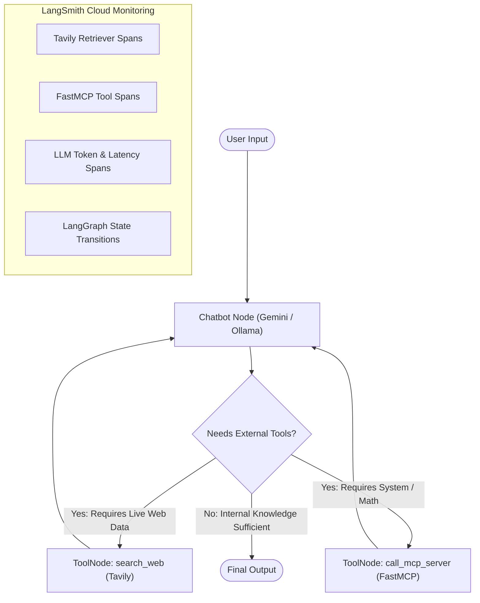

# LangChain & LangGraph AI Agents Application

An AI agent system combining **LangChain**, **LangGraph**, **Google Gemini**, **Ollama**, a local **Model Context Protocol (FastMCP)** server, **Tavily Web Search**, and real-time observability powered by **LangSmith**.

---

## Architecture Overview

Requests entering the application are handled by a stateful **LangGraph** agent. The LLM (Gemini or Ollama) autonomously determines whether its internal knowledge is sufficient or if external tools (`search_web` via Tavily, or `call_mcp_server` via the local FastMCP server) are needed:



---

## Features

- **Autonomous Tool Selection with LangGraph:**
  - **Direct Answer:** If the LLM has sufficient knowledge, it responds directly without unnecessary API or web queries.
  - **On-Demand Web Search:** Calls `search_web` (Tavily) only when live events, real-time facts, or breaking news are needed.
  - **On-Demand MCP Tools:** Calls `call_mcp_server` only when local system status or mathematical calculations are requested.
- **Local FastMCP Server:** Operates over `stdio` without exposing external HTTP ports, providing system diagnostics and mathematical operations.
- **Dual LLM Providers:** Seamlessly switch between **Google Gemini** (Cloud API) and **Ollama** (local models such as `llama3.2`).
- **Complete LangSmith Observability:** Tracks pipeline executions (retrievers, tools, LLM token counts, prompts, graph state transitions).
- **Modern Python Tooling:** Managed with `uv` and Python 3.12+.

---

## Getting Started

### Prerequisites

- [uv](https://docs.astral.sh/uv/) installed on your machine (`brew install uv` or `curl -LsSf https://astral.sh/uv/install.sh | sh`).
- Python `>=3.12`.

### Installation

1. **Clone the repository:**
   ```bash
   git clone https://github.com/maibarra0904/langchain-app.git
   cd langchain-app
   ```

2. **Sync dependencies and create virtual environment:**
   ```bash
   uv sync
   ```

3. **Configure Environment Variables:**
   Copy `.env.example` to `.env`:
   ```bash
   cp .env.example .env
   ```
   Edit `.env` with your API keys:
   ```ini
   # Google Gemini
   GOOGLE_API_KEY="your_gemini_api_key"
   GEMINI_MODEL="gemini-3.5-flash"

   # Ollama (Local)
   OLLAMA_BASE_URL="http://localhost:11434"
   OLLAMA_MODEL="llama3.2"

   # Tavily Search
   TAVILY_API_KEY="tvly-your_tavily_api_key"

   # LangSmith Observability
   LANGSMITH_TRACING="true"
   LANGSMITH_ENDPOINT="https://api.smith.langchain.com"
   LANGSMITH_API_KEY="lsv2_pt_your_langsmith_key"
   LANGSMITH_PROJECT="langchain-app"
   ```

---

## Usage

### 1. Interactive Chat CLI

Launch the interactive conversational interface:
```bash
uv run python main.py
```
*(Or run the installed console script: `uv run langchain-app`)*

#### In-Chat Commands:
- `/search <query>`: Run a standalone search test.
- `/mcp [expression]`: Execute direct MCP server queries with Tavily context preview.
- `/switch`: Toggle between Gemini and Ollama providers.
- `/clear`: Reset conversation state and session history.
- `/exit`: Terminate the session.

### 2. Testing Specific Pathways

- **Test LangSmith connection & view recent cloud traces:**
  ```bash
  uv run python main.py --verify-langsmith
  ```

- **Test Route A (MCP Server + Tavily):**
  ```bash
  uv run python main.py --test-mcp "Check status and calculate 125 * 48 + sqrt(144)"
  ```

- **Test Route B (Tavily Search):**
  ```bash
  uv run python main.py --test-search "LangGraph updates 2026"
  ```

- **Test Route C (General Search Context with Gemini):**
  ```bash
  uv run python main.py --test-search "Explain quantum computing basics" --provider gemini
  ```

---

## Running the Automated Test Suite

Execute unit and integration tests using `pytest`:
```bash
uv run pytest -v
```

---

## Monitoring with LangSmith

Access live traces, token consumption, and execution trees at:
- **[https://smith.langchain.com](https://smith.langchain.com)** (Project: `langchain-app`)

