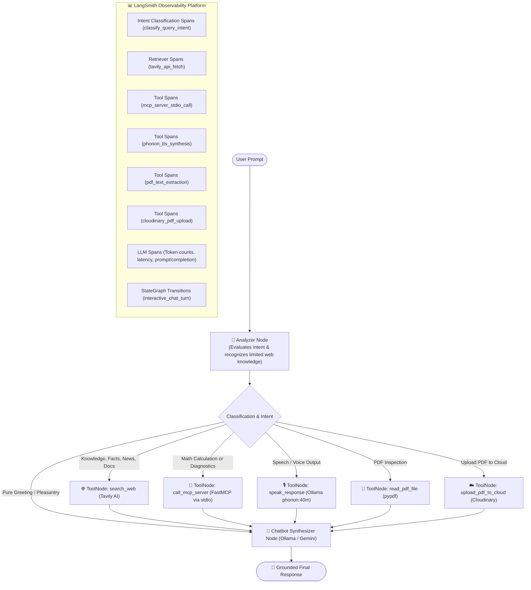

# 🤖 LangChain & LangGraph AI Agent Application

[](https://www.python.org/)
[](https://python.langchain.com/)
[](https://langchain-ai.github.io/langgraph/)
[](https://modelcontextprotocol.io/)
[](https://tavily.com/)
[](https://smith.langchain.com/)
[](https://streamlit.io/)

A production-ready AI Agent framework integrating **LangChain**, **LangGraph**, **Google Gemini**, **Ollama**, a local **Model Context Protocol (FastMCP)** server, **Tavily Web Search**, and full end-to-end observability with **LangSmith**. Features both a **Streamlit Web GUI** and a rich **Interactive CLI**.

---

## 📐 Architecture & Decision Flow

The application implements an intelligible, evidence-driven multi-stage workflow in **LangGraph**. Operating under the explicit premise that the local model has **limited knowledge for web queries and current events**, requests pass through an explicit `analyzer` node before invoking tools or synthesizing answers:



---

## ✨ Features

- **🧠 Intelligible & Grounded Agent Architecture:**
  - **Limited Knowledge Premise:** Recognizes that parametric memory is static and lacks live web access; factual, technical, and real-world inquiries are proactively routed to Tavily Search.
  - **Proactive Web Grounding:** Never leaves Tavily aside for queries about libraries, news, people, documentation, or concepts.
  - **Local FastMCP Server:** Invokes `call_mcp_server` to safely evaluate math expressions via AST parsing or retrieve local machine specs.
  - **Local Voice Generation (TTS):** Invokes `speak_response` to synthesize high-quality spoken audio using Ollama's local `phonon:40m-multilingual` model.
- **🎙️ Full Speech Services (Voice In & Voice Out):**
  - **Speech-to-Text (STT):** Multimodal audio transcription in the Web GUI using microphone recordings.
  - **Text-to-Speech (TTS):** Fast local synthesis with MLX acceleration on Apple Silicon via `phonon:40m-multilingual` (multiple voices: Alba, Borja, Candela, Guillermo, etc.).
- **📄 PDF Ingestion & Cloudinary Cloud Storage:**
  - **Context-First Processing:** Automatically reads, parses page structures, and injects PDF text as prioritized reference context *before* the user's request is executed.
  - **Cloudinary Storage Service:** When a PDF is uploaded, it is automatically backed up to Cloudinary as a raw secure asset with a persistent public HTTPS URL.
  - **LangChain Tool Integration:** Includes `@tool read_pdf_file` to inspect local PDFs and `@tool upload_pdf_to_cloud` to upload documents to Cloudinary on demand.
- **🔐 Google OAuth & Supabase Database:**
  - **Google Sign-In:** Authenticates users via Google OAuth 2.0 with session tracking and developer test login mode.
  - **Supabase Cloud Persistence:** PostgreSQL tables (`users`, `chat_threads`, `document_files`, `document_chunks`) storing user profiles, thread histories, and Cloudinary PDF metadata.
  - **LangChain DB Tool:** Includes `@tool list_cloud_documents` to query uploaded documents recorded in the database.
- **🖥️ Dual Interfaces:**
  - **Web GUI (Streamlit):** Modern chat interface with live tool calling inspection, Cloudinary-backed PDF uploader, LLM provider switching, microphone voice input, audio player, and LangSmith metrics.
  - **Interactive CLI:** Terminal chat loop with shortcuts (`/pdf`, `/search`, `/mcp`, `/speak`, `/switch`, `/clear`, `/exit`).
- **🔀 Multi-Provider LLM Support:**
  - **Google Gemini:** Cloud API (`gemini-3.5-flash` or custom models).
  - **Ollama:** Completely local private execution (`llama3.2` or any local model).
- **📊 100% LangSmith Observability:**
  - Every conversation turn, tool execution, retriever query, and LLM call is recorded and flushed to LangSmith.
- **⚡ Dependency & Package Management:**
  - Managed with **uv** and Python 3.12 for lightning-fast virtual environments and reproducible lockfiles.

---

## 📁 Project Structure

```text
langchain-app/
├── src/
│   └── langchain_app/
│       ├── __init__.py
│       ├── auth_service.py    # Google OAuth 2.0 and session manager
│       ├── cloudinary_service.py # Cloudinary upload and cloud asset service
│       ├── main.py            # LangGraph workflow, CLI & tool definitions
│       ├── mcp_server.py      # Local FastMCP stdio server
│       ├── pdf_service.py     # PDF reading, parsing and prompt context service
│       ├── supabase_service.py # Supabase PostgreSQL database service
│       └── voice_service.py   # Ollama phonon TTS and audio transcription service
├── tests/
│   ├── test_cloudinary_service.py # Unit tests for Cloudinary integration
│   ├── test_mcp_server.py     # Unit tests for MCP server tools
│   ├── test_pdf_service.py    # Unit tests for PDF extraction and prompt formatting
│   ├── test_router.py         # Unit tests for router & graph architecture
│   ├── test_supabase_service.py # Unit tests for Supabase & Google OAuth
│   └── test_voice_service.py  # Unit tests for TTS, audio cleaning & speech tools
├── app.py                     # Streamlit Graphical User Interface with PDF & voice support
├── main.py                    # Root entrypoint redirecting to src/
├── pyproject.toml             # Project metadata, dependencies & scripts
├── uv.lock                    # Dependency lockfile
├── .env.example               # Template for API keys and configuration
└── README.md                  # Project documentation
```

---

## 🚀 Getting Started

### Prerequisites

1. Install [uv](https://docs.astral.sh/uv/) (recommended):
   ```bash
   curl -LsSf https://astral.sh/uv/install.sh | sh
   # or on macOS: brew install uv
   ```
2. Python `>=3.12`.

### Installation

1. **Clone the repository:**
   ```bash
   git clone https://github.com/maibarra0904/langchain-app.git
   cd langchain-app
   ```

2. **Set up the virtual environment and install dependencies:**
   ```bash
   uv sync
   ```

3. **Configure Environment Variables:**
   ```bash
   cp .env.example .env
   ```
   Open [.env](file:///.env) and set your API keys:
   ```ini
   # Google Gemini (https://aistudio.google.com/apikey)
   GOOGLE_API_KEY="your_google_gemini_api_key"
   GEMINI_MODEL="gemini-3.5-flash"

   # Ollama (Local LLM)
   OLLAMA_BASE_URL="http://localhost:11434"
   OLLAMA_MODEL="llama3.2"

   # Tavily Search (https://app.tavily.com)
   TAVILY_API_KEY="tvly-your_tavily_api_key"

   # LangSmith Observability (https://smith.langchain.com)
   LANGSMITH_TRACING="true"
   LANGSMITH_ENDPOINT="https://api.smith.langchain.com"
   LANGSMITH_API_KEY="lsv2_pt_your_langsmith_api_key"
   LANGSMITH_PROJECT="langchain-app"

   # Cloudinary Storage (https://cloudinary.com)
   CLOUDINARY_CLOUD_NAME="your_cloud_name"
   CLOUDINARY_API_KEY="your_cloudinary_api_key"
   CLOUDINARY_API_SECRET="your_cloudinary_api_secret"

   # Supabase Database (https://supabase.com/dashboard)
   SUPABASE_URL="https://your_project.supabase.co"
   SUPABASE_KEY="your_supabase_anon_or_service_key"

   # Google OAuth 2.0 (Google Cloud Console > Credentials)
   GOOGLE_CLIENT_ID="your_google_client_id.apps.googleusercontent.com"
   GOOGLE_CLIENT_SECRET="your_google_client_secret"
   GOOGLE_REDIRECT_URI="http://localhost:8501"
   ```

---

### Database Schema (Supabase PostgreSQL DDL)

To prepare your Supabase database, run the following SQL script in your Supabase SQL Editor:

```sql
-- 1. Usuarios vinculados con Google OAuth
CREATE TABLE IF NOT EXISTS users (
    id UUID PRIMARY KEY DEFAULT gen_random_uuid(),
    google_id VARCHAR(255) UNIQUE NOT NULL,
    email VARCHAR(255) UNIQUE NOT NULL,
    full_name VARCHAR(255),
    avatar_url TEXT,
    created_at TIMESTAMPTZ DEFAULT NOW()
);

-- 2. Hilos de conversación (alineados al thread_id de LangGraph)
CREATE TABLE IF NOT EXISTS chat_threads (
    id VARCHAR(255) PRIMARY KEY,
    user_id UUID REFERENCES users(id) ON DELETE CASCADE,
    title VARCHAR(255) DEFAULT 'Nueva conversación',
    created_at TIMESTAMPTZ DEFAULT NOW(),
    updated_at TIMESTAMPTZ DEFAULT NOW()
);

-- 3. Archivos subidos a Cloudinary
CREATE TABLE IF NOT EXISTS document_files (
    id UUID PRIMARY KEY DEFAULT gen_random_uuid(),
    thread_id VARCHAR(255) REFERENCES chat_threads(id) ON DELETE SET NULL,
    user_id UUID REFERENCES users(id) ON DELETE CASCADE,
    cloudinary_public_id VARCHAR(255) NOT NULL,
    secure_url TEXT NOT NULL,
    file_name VARCHAR(255) NOT NULL,
    file_size_bytes INT,
    created_at TIMESTAMPTZ DEFAULT NOW()
);

-- 4. Chunks de PDFs para búsqueda semántica (RAG)
CREATE TABLE IF NOT EXISTS document_chunks (
    id UUID PRIMARY KEY DEFAULT gen_random_uuid(),
    document_id UUID REFERENCES document_files(id) ON DELETE CASCADE,
    chunk_index INT NOT NULL,
    content TEXT NOT NULL,
    page_number INT,
    created_at TIMESTAMPTZ DEFAULT NOW()
);
```

---

## 💻 Usage

### 1. Graphical User Interface (Streamlit Web UI)

Launch the web application:
```bash
uv run python main.py --ui
```
*(Alternative: `uv run streamlit run app.py`)*

Open your browser at **`http://localhost:8501`**:
- **Live Chat:** Conversational UI with markdown, code highlights, and KaTeX math formulas.
- **Microphone Voice Interaction:** Speak directly via the microphone (`st.audio_input`). Audio is transcribed and automatically routed to the local **Ollama** LLM, responding with both text and voice synthesis via `phonon:40m`.
- **Provider Switcher:** Toggle between Google Gemini (Cloud) and Ollama (Local) for text inputs in the sidebar.
- **PDF Uploader:** Upload and ingest PDF documents with context-first injection before queries.
- **Execution Inspector:** View which tools were called, input parameters, and raw outputs.
- **Quick Action Buttons:** Run diagnostic checks or sample calculations with one click.
- **LangSmith Live Status:** Direct link to your monitoring dashboard and recent runs list.

---

### 2. Interactive Terminal CLI

Launch the interactive terminal session:
```bash
uv run python main.py
```
*(Or use the installed console script: `uv run langchain-app`)*

#### In-Chat Slash Commands:
- `/pdf <path>`: Load and inject a PDF file as reference context for your query.
- `/search <query>`: Perform a direct Tavily web search test.
- `/mcp [expression]`: Perform a direct local FastMCP server query.
- `/speak <text>`: Synthesize text into audio using local Ollama phonon.
- `/switch`: Toggle between Gemini and Ollama providers on the fly.
- `/clear`: Clear session conversation history.
- `/exit` or `/quit`: Exit the program.

---

### 3. Command Line Testing Shortcuts

- **Verify LangSmith Tracing & Cloud Connectivity:**
  ```bash
  uv run python main.py --verify-langsmith
  ```

- **Query Grounded on a PDF Document:**
  ```bash
  uv run python main.py --pdf document.pdf "Summarize the key conclusions"
  ```

- **Direct Web Search via CLI (Bypassing LLM):**
  ```bash
  uv run python main.py --test-search "LangGraph stateful agents 2026"
  ```

- **Search Assisted by LLM (Gemini evaluates and summarizes):**
  ```bash
  uv run python main.py --test-search "Latest AI breakthroughs in 2026" --provider gemini
  ```

- **Local FastMCP Server Test:**
  ```bash
  uv run python main.py --test-mcp "Calculate sqrt(144) + 125 * 48 and check system status"
  ```

---

## 🧪 Automated Testing

Run the test suite with `pytest`:
```bash
uv run pytest -v
```

All 46 tests cover:
- **Google OAuth & Supabase Database:** Environment configuration checks, user upsert synchronization, chat thread creation, Cloudinary document metadata registration, and `@tool list_cloud_documents` (`test_supabase_service.py`).
- **Intelligible Intent & Limited Knowledge Routing:** Classification of knowledge queries to Tavily, math to MCP, voice to phonon, PDF to reader, cloud storage to Cloudinary, and greetings to direct chat (`test_router.py`).
- **Cloudinary Storage Service:** Uploads from memory byte streams, local disk uploads, error handling on unconfigured credentials or missing files, and `@tool upload_pdf_to_cloud` execution (`test_cloudinary_service.py`).
- **PDF Ingestion & Context Injection:** Memory byte stream parsing, local disk reading, error handling on missing files, and `@tool read_pdf_file` invocations (`test_pdf_service.py`).
- **MCP Server Capabilities:** Safe AST function evaluation (`sqrt`, `sin`, `abs`, etc.), arithmetic operations, and system diagnostic retrieval (`test_mcp_server.py`).
- **Graph & Tool Registry:** Verification of LangGraph routing and registration of all 6 services: `search_web`, `call_mcp_server`, `speak_response`, `read_pdf_file`, `upload_pdf_to_cloud`, and `list_cloud_documents` (`test_router.py`).
- **Speech Services:** Phonon TTS synthesis, audio format conversion, text sanitization, and fallback behaviors (`test_voice_service.py`).

---

## 📈 LangSmith Live Observability

All turns and tool calls are automatically traced. Inspect latency, token costs, prompt inputs, and execution trees at:
👉 **[https://smith.langchain.com](https://smith.langchain.com)** (Project: `langchain-app`)

---

## 📄 License

This project is licensed under the MIT License.
